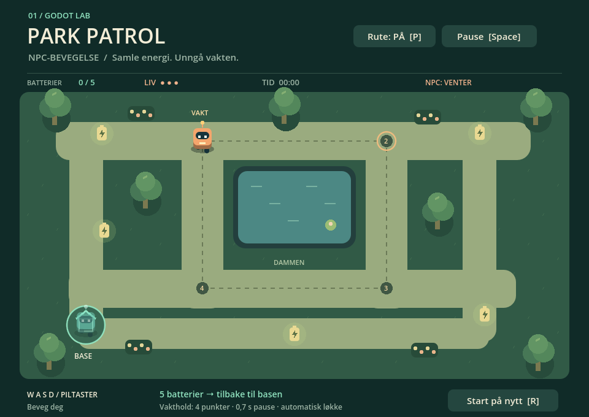

# Park Patrol — NPC-bevegelse



A small 2D Godot game for the assignment **NPC-bevegelse**. Collect five batteries in a park, avoid the autonomous guard, and return to the base. Three encounters with the guard end the game.

## Start

Open `project.godot` in **Godot 4.7** and press **F6** with `scenes/main.tscn` open, or **F5** to run the project. No add-ons, downloads, or paid assets are required. The graphics are drawn in GDScript.

| Control | Action |
| --- | --- |
| WASD / arrow keys | Move the mint robot |
| P / Rute button | Show or hide the NPC patrol route |
| Space / Pause button | Pause or resume |
| R / Start på nytt | Restart |

## NPC-bevegelse — forklaring til oppgaven

**Mål:** Lage en figur som beveger seg uten at spilleren styrer den.

Den oransje roboten er en NPC. Den patruljerer mellom fire faste punkter rundt dammen. NPC-en bruker ikke tastaturet. Den finner retningen til neste punkt med `direction_to()`, setter `velocity` til retningen multiplisert med `speed`, og beveger seg med `move_and_slide()` i `_physics_process(delta)`.

Når roboten kommer fram, stopper den i **0,7 sekunder**. Deretter økes `target_index`. Modulo (`%`) gjør at roboten går tilbake til det første punktet etter det siste. Dermed fortsetter patruljen i en løkke. Det siste steget begrenses slik at NPC-en ikke går forbi målet og vibrerer.

Tre enkle tilstander: **MOVE → ARRIVE → WAIT → MOVE**.

- `speed`: 115 piksler per sekund.
- `pause_duration`: 0,7 sekunder ved hvert punkt.
- `waypoints`: fire punkter i verdenskoordinater.
- `target_index`: punktet NPC-en går mot nå.
- `wait_remaining`: tiden som gjenstår av pausen.

Dette er **patruljering mellom faste punkter**, ikke pathfinding. Ruten er laget slik at NPC-en går rundt dammen. Ved vilkårlige hindringer vil man trenge en annen løsning, for eksempel `NavigationAgent2D`.

**Forsøk selv:** Endre `speed`, `pause_duration` eller koordinatene i `scripts/npc.gd`, og se hvordan oppførselen endrer seg. P-knappen viser punktene og markerer det neste målet.

## Пояснення українською

Помаранчевий робот — NPC, який рухається самостійно. Він обходить чотири точки навколо ставка та чекає 0,7 секунди на кожній. Після останньої точки повертається до першої. Гравець не керує NPC.

У `scripts/npc.gd` є весь алгоритм із коментарями: визначити напрямок → рухатися до точки → зупинитися → вибрати наступну. `speed` задає швидкість, `waypoints` — маршрут, `pause_duration` — тривалість зупинки. Це просте патрулювання без пошуку шляху.

Гравець має зібрати 5 батарейок і повернутися на базу внизу ліворуч. Не торкайся охоронця: кожна зустріч забирає одне життя. Є три життя, пауза та перезапуск.

## Files

- `scripts/npc.gd` — autonomous NPC patrol, the main assignment.
- `scripts/player.gd` — keyboard movement.
- `scripts/actor.gd` — shared robot appearance and collision shape.
- `scripts/main.gd` — park, collectibles, UI, win/loss conditions.
- `scenes/main.tscn` — entry scene (characters and scenery are created in `_ready()`).
- `tests/smoke.gd` — checks patrol loop, pause, pond collision, pickups, win, loss, restart.

## Verification

```sh
godot --headless --path . --fixed-fps 120 --script tests/smoke.gd
```

Reference: [Godot 2D movement documentation](https://docs.godotengine.org/en/stable/tutorials/2d/2d_movement.html).
